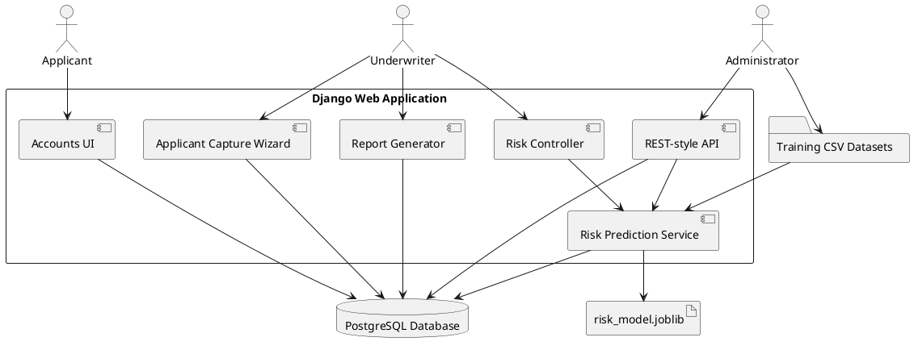
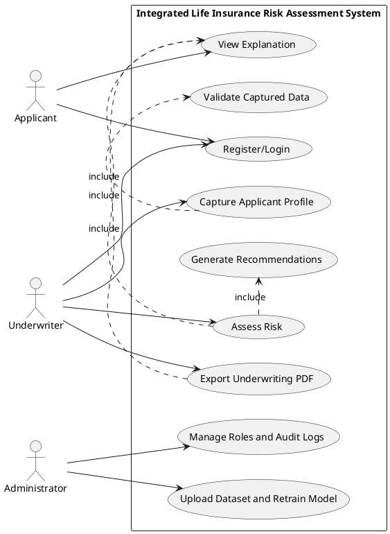
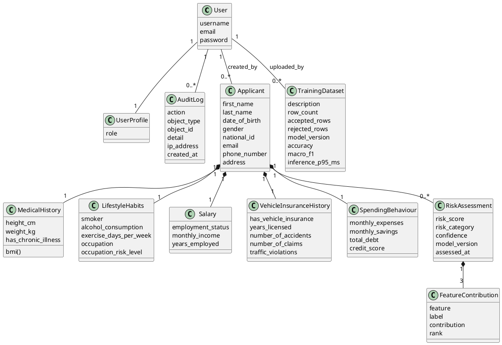
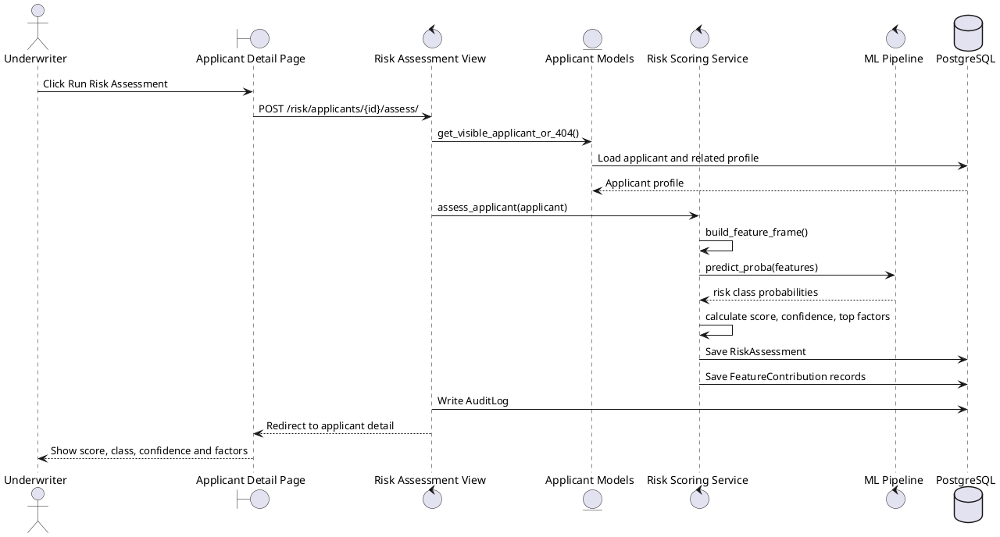
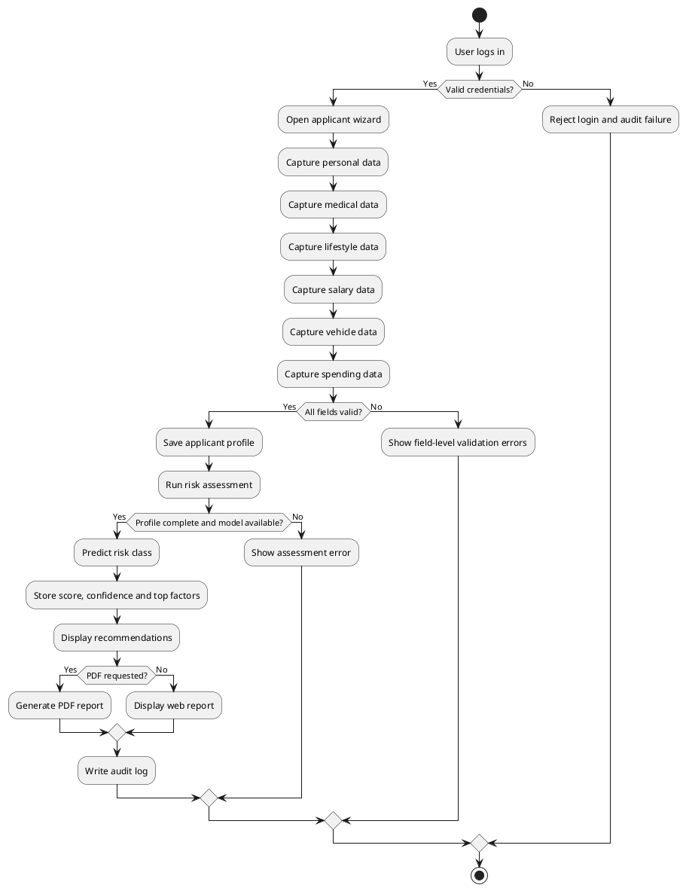
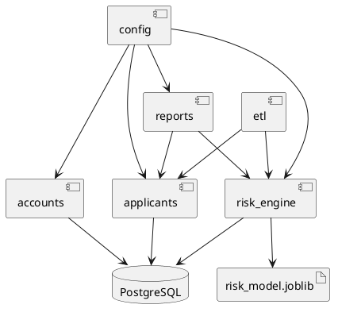
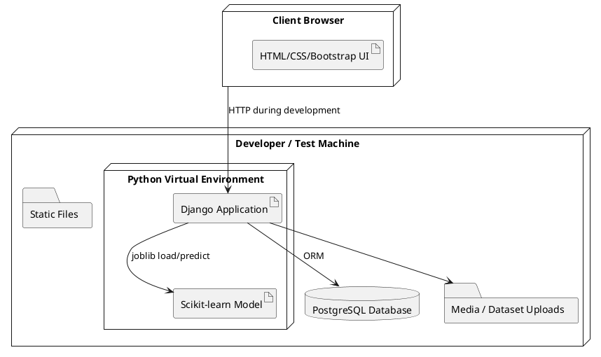

# ISJ107V Assignment 3: Project Documentation and UML Design

> **Demonstration verification:** 66 automated tests pass, including the three-role
> journey and PDF exports. Results remain academic/experimental. See
> DEMONSTRATION_WALKTHROUGH.md and Assignment3_Screenshot_Checklist.md for current
> procedures. No claim of completed browser UAT or external deployment is made.

> **Training update:** Labelled applicant CSV ingestion is implemented and tested.
> It uses actual form fields and supplied underwriting labels without Kaggle mapping.
> See evaluation/APPLICANT_DATA_CONTRACT.md. Real data and provenance approval are
> still required; no new production model has been activated.

> **New research evidence:** The native Kaggle benchmark scored 75.06% accuracy
> and 0.6718 macro F1. It is not compatible with live form inputs and remains
> research-only. See evaluation/RESULTS.md; no production-readiness claim is warranted.

> **Current evidence:** See the Deployment Audit Update at the end. Historical
> model metrics below are superseded by accuracy 0.608 and macro F1 0.514.

Student: Mc Makwela  
Project: Integrated Life Insurance Risk Assessment System using Artificial Intelligence and Machine Learning  
Module: ISJ107V  
Date: 30 September 2026  
Version: 1.0

## Question 1: Final Project Baseline [6]

### 1.1 Project Title, Purpose, Users, Emerging Technology and Executive Summary

**Project title:** Integrated Life Insurance Risk Assessment System using Artificial Intelligence and Machine Learning.

**System purpose:**  
The system supports life insurance underwriting by collecting applicant personal, medical, lifestyle, vehicle insurance, salary and spending information, then using a trained machine learning model to classify the applicant as Low, Medium or High risk. The system also stores the assessment result, risk score, confidence value, top contributing risk factors, lifestyle recommendations and an underwriting report that can be exported as a PDF.

**Intended users:**

| User | Purpose |
|---|---|
| Applicant | Views risk assessment outcome and recommendations. |
| Underwriter | Captures applicant data, runs risk assessments and reviews reports. |
| Administrator | Manages users, roles, training datasets, audit logs and model retraining. |

**Selected emerging technology:**  
Artificial Intelligence / Machine Learning, implemented as a supervised classification model using Scikit-learn. The model is trained on structured applicant features and integrated into the Django application through the internal risk scoring service.

**Executive summary:**  
The final implementation is a Django-based web application named Assure Risk. It provides authenticated access, role-based applicant visibility, a six-step applicant capture wizard, machine-learning risk scoring, model confidence reporting, top-three feature contribution explanations, lifestyle recommendations, PDF underwriting reports, audit logging, and REST-style API endpoints. The latest model evaluation used 20,000 generated applicant records plus 20,000 transformed Kaggle/Prudential records and achieved accuracy of 0.935, macro F1-score of 0.920, and 95th percentile inference latency of 5.74 ms, meeting the core emerging-technology targets.

### 1.2 Final Aim, Objectives, Scope and Approved Changes

**Final aim:**  
To implement and evaluate an integrated, AI-driven life insurance risk assessment system that produces fast, consistent and explainable risk classifications from consolidated applicant data.

**Measurable objectives:**

| ID | Objective | Final status |
|---|---|---|
| OBJ-01 | Consolidate applicant personal, medical, lifestyle, vehicle, salary and spending data into one application data layer. | Achieved through Django models and a six-step applicant wizard. |
| OBJ-02 | Train and deploy a supervised risk classification model with at least 85% accuracy and macro F1-score of at least 0.80. | Achieved: accuracy 0.935, macro F1 0.920. |
| OBJ-03 | Reduce assessment completion time to under five minutes for a complete applicant profile. | Achieved in system design through a guided capture wizard and one-click risk assessment. |
| OBJ-04 | Provide explainable assessment output with confidence, top contributing factors and recommendations. | Achieved through `RiskAssessment`, `FeatureContribution` and recommendation logic. |
| OBJ-05 | Provide auditability and controlled access to applicant information. | Achieved through authentication, role profiles, applicant visibility controls and `AuditLog`. |

**Scope:**

| In scope | Out of scope |
|---|---|
| Individual life insurance risk assessment | Premium billing |
| Applicant data capture and validation | Payment processing |
| ML-based risk classification | Fully automated policy issuing |
| Explainable risk result and confidence | Live external API integrations |
| Underwriting report and PDF export | Native mobile application |
| Audit logging and role-based access | Production hosting on a cloud VM for this submission |
| Dataset upload and retraining endpoint | Real insurer production dataset |

**Approved or justified changes since Assignment 2:**

| Area | Assignment 2 proposal | Final implementation | Justification |
|---|---|---|---|
| Database | MySQL 8 | PostgreSQL configured in `config/settings.py` | PostgreSQL is a reliable relational database supported by Django and already configured for the project environment. |
| PDF library | ReportLab | ReportLab | ReportLab generates server-side PDF underwriting reports. |
| API framework | Django REST Framework | Django JSON views | The project implements the documented REST-style endpoints using Django views to reduce dependency complexity while preserving the required API behavior. |
| Model algorithm | Random Forest / Gradient Boosting | Gradient Boosting classifier | Gradient Boosting achieved the required accuracy and macro F1-score on the final training run. |

### 1.3 Document Control

**Document control:**

| Field | Value |
|---|---|
| Document title | Assignment 3: Project Documentation and UML Design |
| Version | 1.0 |
| Date | 30 September 2026 |
| Author | Mc Makwela |
| Project | Integrated Life Insurance Risk Assessment System |
| Status | Final submission draft |

**Revision history:**

| Version | Date | Author | Change |
|---|---|---|---|
| 0.1 | 22 September 2026 | Mc Makwela | Assignment 2 proposal baseline completed. |
| 0.8 | 30 September 2026 | Mc Makwela | Final implementation reviewed against requirements. |
| 1.0 | 30 September 2026 | Mc Makwela | Assignment 3 documentation completed. |

**Glossary:**

| Term | Meaning |
|---|---|
| Applicant | Person applying for life insurance. |
| Underwriter | Insurance user who captures data and reviews risk outcomes. |
| Risk score | Numeric score between 0 and 100 representing risk severity. |
| Risk category | Low, Medium or High classification. |
| Confidence | Model confidence for the selected risk class. |
| Feature contribution | A factor that influenced the risk outcome. |
| ML | Machine Learning. |
| POPIA | Protection of Personal Information Act. |
| Audit log | Record of access, changes and security-relevant events. |

**Referenced project artefacts:**

| Artefact | Location |
|---|---|
| Django settings | `config/settings.py` |
| URL routing and APIs | `config/urls.py`, `risk_engine/api.py` |
| Applicant models | `applicants/models.py` |
| Risk models | `risk_engine/models.py` |
| Risk scoring service | `risk_engine/scoring.py` |
| ML pipeline | `risk_engine/pipeline.py` |
| Training command | `risk_engine/management/commands/train_risk_model.py` |
| Audit logging | `accounts/models.py`, `accounts/audit.py` |
| Reports | `reports/views.py`, `reports/templates/reports/` |
| Tests | `applicants/tests.py`, `risk_engine/tests.py` |

## Question 2: Requirements and Traceability [8]

### 2.1 Final Functional and Non-Functional Requirements

**Functional requirements:**

| ID | Priority | Requirement | Acceptance criterion |
|---|---|---|---|
| FR-01 | Must | The system shall allow users to register and authenticate. | Valid users can log in and invalid login attempts are rejected and audit logged. |
| FR-02 | Must | The system shall capture applicant personal details. | A complete personal details form creates an `Applicant` record. |
| FR-03 | Must | The system shall capture medical history. | Medical data is linked to the applicant and shown on the applicant detail page. |
| FR-04 | Must | The system shall validate captured fields. | Invalid ID, age, BMI, credit score or spending values are rejected with form errors. |
| FR-05 | Must | The system shall capture lifestyle, vehicle, salary and spending data. | All five profile sections are stored as linked records. |
| FR-06 | Must | The system shall classify applicant risk. | A complete applicant profile can be assessed and produces a stored `RiskAssessment`. |
| FR-07 | Must | The system shall explain predictions. | Each assessment stores and displays three ranked contributing factors. |
| FR-08 | Should | The system shall generate an underwriting report and PDF. | The report page and PDF export show applicant summary, score, category, confidence and factors. |
| FR-09 | Should | The system shall generate lifestyle recommendations. | Recommendations appear on applicant details and reports. |
| FR-10 | Could | The system shall support administrator dataset upload and retraining. | Administrator API accepts a dataset upload and triggers model training. |

**Non-functional requirements:**

| ID | Category | Requirement | Acceptance criterion |
|---|---|---|---|
| NFR-01 | Usability | The system shall guide users through a complete assessment workflow. | A six-step wizard allows structured profile capture. |
| NFR-02 | Reliability | The same model version shall return consistent classes for identical input. | The saved model file is loaded and used consistently by the scoring service. |
| NFR-03 | Performance | The system shall return ML inference within 50 ms p95. | Latest measured p95 inference latency is 5.74 ms. |
| NFR-04 | Security | The system shall protect access and record audit events. | Authentication, role visibility and `AuditLog` are implemented. |
| NFR-05 | Maintainability | The system shall separate accounts, applicants, risk, reports and ETL concerns. | Code is divided into Django apps with focused responsibilities. |

### 2.2 Requirements Traceability Matrix

| Requirement | UML reference | Module | Test case / evidence | Status |
|---|---|---|---|---|
| FR-01 | UC-01 Register/Login | `accounts/views.py`, `accounts/forms.py` | Login and registration workflow; audit logs implemented | Pass |
| FR-02 | UC-02 Capture Applicant | `applicants/models.py`, `applicants/views.py` | `ApplicantCreateWizardTests` | Pass |
| FR-03 | UC-03 Capture Medical History | `applicants/models.py`, `applicants/forms.py` | Wizard saves `MedicalHistory` | Pass |
| FR-04 | UC-04 Validate Captured Data | `applicants/forms.py` | Form validation tests and form errors | Pass |
| FR-05 | UC-05 Capture Full Profile | `applicants/views.py` | Wizard stores all profile sections | Pass |
| FR-06 | UC-06 Assess Risk | `risk_engine/scoring.py`, `risk_engine/views.py` | `RiskAssessmentViewTests` | Pass |
| FR-07 | UC-07 Explain Prediction | `risk_engine/models.py`, `risk_engine/scoring.py` | Feature contributions shown in detail/report templates | Pass |
| FR-08 | UC-08 Export Report | `reports/views.py` | `ReportTests.test_pdf_export_returns_pdf_response` | Pass |
| FR-09 | UC-09 Generate Recommendations | `risk_engine/recommendations.py` | `RecommendationTests` | Pass |
| FR-10 | UC-10 Upload Dataset/Retrain | `risk_engine/api.py`, `train_risk_model.py` | API endpoint and training command | Partial: endpoint exists; full rollback UI not implemented |
| NFR-01 | Activity Diagram AD-01 | `applicants/templates/applicants/applicant_form.html` | Six-step guided wizard | Pass |
| NFR-02 | Component Diagram CD-01 | `risk_engine/ml_models/risk_model.joblib` | Stable model artifact used by scoring service | Pass |
| NFR-03 | Deployment Diagram DD-01 | `train_risk_model.py` | p95 inference latency 5.74 ms | Pass |
| NFR-04 | Security Model SM-01 | `accounts/models.py`, `applicants/permissions.py` | AuditLog and role visibility | Pass |
| NFR-05 | Component Diagram CD-01 | Project package structure | Modular Django apps | Pass |

### 2.3 Emerging Technology Requirements

| ID | Requirement | Implementation evidence | Result |
|---|---|---|---|
| ETR-01 | The ML model shall classify applicant risk with accuracy >= 0.85 and macro F1 >= 0.80. | `train_risk_model.py` trains a Gradient Boosting classifier. Latest run: accuracy 0.935, macro F1 0.920. | Pass |
| ETR-02 | The prediction service shall return class, score and explanation within 50 ms p95. | Latest measured p95 inference latency is 5.74 ms. The scoring service returns risk category, risk score, confidence and top factors. | Pass |
| ETR-03 | The prediction service shall support retraining and model versioning. | `api_upload_dataset` accepts administrator dataset upload and triggers training. `TrainingDataset` stores model version and metrics. | Partial: retraining/version record exists; full rollback interface remains future work. |

## Question 3: Final Design as Implemented [16]

### 3.1 High-Level System Architecture Diagram

Use a UML tool to draw the following architecture:

**Design decision:**  
The application is implemented as a modular Django system. The web interface and API share the same model layer, while the ML service is isolated in `risk_engine/scoring.py` and `risk_engine/pipeline.py` so that the classifier can be retrained or replaced without rewriting the applicant capture and report modules.

### 3.2 Use-Case Diagram and Detailed Use Case

**Detailed use case: UC-04 Assess Risk**

| Field | Description |
|---|---|
| Use case | UC-04 Assess Risk |
| Primary actor | Underwriter |
| Supporting component | Risk Prediction Service |
| Preconditions | User is authenticated; applicant profile is complete. |
| Trigger | Underwriter selects "Run Risk Assessment". |
| Normal flow | 1. System loads applicant profile. 2. System validates that all required related records exist. 3. System builds the feature vector. 4. ML model predicts risk class and confidence. 5. System calculates risk score and top three contributing factors. 6. System stores `RiskAssessment` and `FeatureContribution` records. 7. System redirects to applicant detail page and displays result. |
| Alternative flow | If the profile is incomplete, the system displays an error and does not create an assessment. If the model file is missing, the system displays a model-not-trained error. |
| Postconditions | Risk assessment is stored and audit logged. |

### 3.3 Class Diagram

### 3.4 Sequence Diagram for Core Transaction

### 3.5 Activity Diagram

### 3.6 Component and Deployment Diagrams

**Component diagram:**

**Deployment diagram:**

## Question 4: Implemented Solution Documentation [10]

### 4.1 Technology Stack, Structure, Modules and Screenshots

**Technology stack:**

| Layer | Technology |
|---|---|
| Backend | Python, Django 5.2 |
| Database | PostgreSQL for runtime, SQLite for test settings |
| Machine learning | Scikit-learn, Pandas, NumPy, joblib |
| Frontend | HTML, CSS, Bootstrap icons/classes, Django templates |
| Reporting | ReportLab PDF rendering |
| Testing | Django TestCase |

**Project structure:**

| Module | Responsibility |
|---|---|
| `accounts` | Authentication, registration, roles, audit logs and dashboard. |
| `applicants` | Applicant profile models, validation, wizard, permissions and detail/list pages. |
| `risk_engine` | ML features, pipeline, scoring, risk assessment models, API and training command. |
| `reports` | Web underwriting reports and PDF exports. |
| `etl` | Synthetic data generation and CSV applicant import. |
| `config` | Settings, URL routing and project configuration. |
| `templates` / `static` | Shared layout and styling. |

**Screenshots to include in the final submission:**

| Screenshot | Caption |
|---|---|
| Login page | Figure 1: Secure user authentication page. |
| Dashboard | Figure 2: Underwriter dashboard showing applicant and risk summary. |
| Applicant wizard | Figure 3: Six-step applicant data capture workflow. |
| Applicant detail after assessment | Figure 4: Risk score, confidence and top contributing factors. |
| Underwriting report | Figure 5: Generated underwriting report with recommendations. |
| Django admin audit logs | Figure 6: Administrator audit trail and training dataset records. |

### 4.2 Database, Dataset, Validation, Privacy and Backup

**Main entities:**

| Entity | Key fields | Purpose |
|---|---|---|
| User | username, email, password hash | Authentication identity. |
| UserProfile | user, role | Role-based access. |
| AuditLog | user, action, object, detail, IP, created_at | Security and access audit trail. |
| Applicant | identity, contact and demographic fields | Main applicant record. |
| MedicalHistory | height, weight, chronic illness, family history | Medical risk factors. |
| LifestyleHabits | smoker, alcohol, exercise, occupation risk | Lifestyle risk factors. |
| Salary | employment status, income, years employed | Income and employment profile. |
| VehicleInsuranceHistory | licence years, accidents, claims, violations | Driving and insurance risk. |
| SpendingBehaviour | expenses, savings, debt, credit score | Financial risk profile. |
| RiskAssessment | score, category, confidence, model version | ML assessment result. |
| FeatureContribution | feature, label, contribution, rank | Explainability output. |
| TrainingDataset | dataset details, model version, metrics | Training and retraining record. |

**Validation rules:**

| Field | Rule |
|---|---|
| Identity number | Must be exactly 13 numeric digits. |
| Date of birth | Applicant age must be 18 to 75 years. |
| BMI | Must be between 10 and 60. |
| Exercise days | 0 to 7. |
| Credit score | 300 to 850. |
| Monthly expenses | May not exceed salary by more than 200%. |
| Required profile sections | Risk assessment requires medical, lifestyle, salary, vehicle and spending records. |

**Privacy controls:**

| Control | Implementation |
|---|---|
| Authentication | Django login and password hashing. |
| Role-based access | `UserProfile` and `visible_applicants_for()`. |
| Applicant visibility | Underwriters see their own captured applicants; applicants see records matching their email; administrators see all. |
| Audit trail | `AuditLog` stores login, access, changes, reports, assessments and model training events. |
| CSRF protection | Django middleware enabled for browser forms. |
| Secure production cookies | Enabled when `DEBUG=False`. |

**Backup approach:**  
For a production deployment, the PostgreSQL database should be backed up nightly using `pg_dump` with encrypted off-site storage. Uploaded datasets and model files should be included in file-system backups. A weekly restore test should be performed on a staging environment to verify recovery.

### 4.3 Main API / Integration Interface

| Method | Endpoint | Auth | Input | Output | Errors |
|---|---|---|---|---|---|
| POST | `/api/v1/auth/register` | None | username, email, password, role | `201`, userId | `400` missing fields |
| POST | `/api/v1/auth/login` | None | username, password | session token, userId | `401` invalid credentials |
| POST | `/api/v1/applicants` | Login | applicant, medical, lifestyle, salary, vehicle, spending JSON | `201`, applicantId | `400` validation errors |
| POST | `/api/v1/predict-risk` | Login | applicantId | riskClass, riskScore, confidence, modelVersion, topFactors | `422` incomplete profile, `503` missing model |
| GET | `/api/v1/assessments/{id}` | Login | assessment id | full assessment with recommendations | `404` hidden or missing record |
| GET | `/api/v1/reports/{id}` | Login | assessment id | PDF report | `404` hidden or missing record |
| POST | `/api/v1/datasets` | Administrator | CSV file and description | datasetId, retrainingJobId, modelVersion | `403` not administrator, `400` missing file |

**Error handling:**  
Invalid inputs return field-level JSON errors. Unauthenticated users are redirected or rejected. Hidden applicant records return 404 to avoid disclosing their existence. Missing or incomplete ML profiles return meaningful assessment errors.

### 4.4 Installation, Configuration and Deployment

**Minimum requirements:**

| Component | Minimum |
|---|---|
| CPU | 2-core x86-64 |
| RAM | 4 GB |
| Storage | 20 GB free |
| OS | Windows 10/11 or Ubuntu Linux |
| Python | Compatible with installed project environment |
| Database | PostgreSQL |

**Local installation steps:**

1. Open a terminal in the project directory.
2. Create or activate the Python virtual environment.
3. Install dependencies with `pip install -r requirements.txt`.
4. Create a `.env` file with `SECRET_KEY`, `DEBUG`, `ALLOWED_HOSTS`, `DB_NAME`, `DB_USER`, `DB_PASSWORD`, `DB_HOST` and `DB_PORT`.
5. Run migrations: `python manage.py migrate`.
6. Create an administrator: `python manage.py createsuperuser`.
7. Train the model: `python manage.py train_risk_model --rows 20000`.
8. Start the server: `python manage.py runserver 127.0.0.1:8000`.
9. Open `http://127.0.0.1:8000/`.

**Deployment notes:**  
For production, run Django behind Gunicorn and Nginx, set `DEBUG=False`, configure HTTPS, secure cookies, static file collection, database backups and restricted environment variables. Model files and uploaded datasets must be backed up with the database.

## Question 5: Evaluation and Responsible Use [10]

### 5.1 Test Summary

| Test type | Test case | Expected result | Actual result | Status | Evidence |
|---|---|---|---|---|---|
| Unit | Applicant DOB validation | Future and out-of-range dates are rejected. | Validation errors returned. | Pass | `ApplicantFormValidationTests` |
| Unit | Recommendation generation | High-risk habits generate targeted recommendations. | Smoking, alcohol, BMI and savings recommendations returned. | Pass | `RecommendationTests` |
| Integration | Applicant wizard | Complete wizard saves all linked profile sections. | Applicant, medical, lifestyle, salary, vehicle and spending records created. | Pass | `ApplicantCreateWizardTests` |
| Integration | Access control | Normal users cannot view other users' applicants. | Hidden applicant returns 404. | Pass | `ApplicantAccessTests` |
| Integration | Risk assessment | Owner can assess own applicant; other user cannot. | Correct redirect and access behavior. | Pass | `RiskAssessmentViewTests` |
| System | Underwriting report | Report displays assessment and recommendations. | Report page contains risk score and recommendations. | Pass | `ReportTests` |
| System | PDF export | PDF endpoint returns PDF response. | Content type `application/pdf`. | Pass | `ReportTests.test_pdf_export_returns_pdf_response` |

**Automated test result:**  
`python manage.py test --settings=config.test_settings`  
Result: 33 tests run, all passed.

### 5.2 Non-Functional and Emerging Technology Evaluation

| Requirement | Metric | Result | Evaluation |
|---|---|---|---|
| NFR-03 Performance | ML p95 inference time below 50 ms | 5.74 ms | Pass |
| NFR-04 Security | Authentication, role access and audit logs | Implemented in `accounts` and `applicants.permissions` | Pass |
| ETR-01 ML quality | Accuracy >= 0.85 and macro F1 >= 0.80 | Accuracy 0.935, macro F1 0.920 | Pass |

### 5.3 User Guide and Troubleshooting

**Main workflow:**

1. Open the web application.
2. Register or log in.
3. From the dashboard, select **New Applicant**.
4. Complete the six capture steps: personal, medical, lifestyle, salary, vehicle and spending.
5. Open the applicant detail page.
6. Select **Run Risk Assessment**.
7. Review the risk score, class, confidence and top contributing factors.
8. Review lifestyle recommendations.
9. Select **Report** to view the underwriting report.
10. Select **PDF** to download the report.

**Troubleshooting:**

| Problem | Likely cause | Fix |
|---|---|---|
| Cannot log in | Incorrect credentials | Reset password or create a valid user. |
| Applicant form will not save | Validation error | Check ID number, age, BMI, credit score and spending values. |
| Risk assessment fails | Incomplete applicant profile | Ensure all six profile sections were completed. |
| Model-not-trained error | Missing `risk_model.joblib` | Run `python manage.py train_risk_model --rows 20000`. |
| PDF export unavailable | PDF generation error or missing package | Check server logs and ensure ReportLab is installed from `requirements.txt`. |
| User cannot see applicant | Role or ownership restriction | Use administrator account or assign correct user/role. |

### 5.4 Limitations, Risks, Ethics, Maintenance and Future Improvements

**Current limitations:**

1. The model is trained on synthetic data rather than a real insurer dataset.
2. Dataset upload and retraining exist through the API, but there is no full administrator web screen for rollback.
3. Live integrations with medical aid, credit bureau or transport authority systems are not implemented.
4. The system supports underwriting decisions but does not issue policies or calculate premiums.

**Unresolved risks:**

| Risk | Impact | Mitigation |
|---|---|---|
| Synthetic data may not represent real applicants. | Model may perform differently in production. | Validate with real de-identified insurer data before production use. |
| Bias in historical or synthetic labels. | Unfair risk decisions across demographic groups. | Run fairness checks by age and gender before release. |
| Sensitive personal and medical data exposure. | POPIA and trust risk. | Enforce access control, audit logs, HTTPS and database encryption. |
| Model drift over time. | Predictions become less accurate. | Monitor live prediction distribution and retrain periodically. |

**Ethical and security concerns:**  
The system uses personal, medical and financial data. It must therefore follow data minimisation, explicit consent, access control and auditability. The model output must support human underwriting rather than replace human judgement. Applicants should be able to request an explanation of automated risk decisions.

**Maintenance needs:**

1. Regular dependency updates and security patching.
2. Scheduled database and model backup verification.
3. Periodic model retraining and metric review.
4. Audit log review for suspicious access patterns.
5. Test suite updates as new requirements are added.

**Future improvements:**

1. Add a full administrator web interface for dataset upload, model comparison and rollback.
2. Add fairness dashboards showing model performance by gender, age band and other protected or sensitive groups.

# Deployment Audit Update (2026-10-17)

Historical metrics and completion claims below require revision against DEPLOYMENT.md.
The leakage-corrected Kaggle-only run measured accuracy 0.608 and macro F1 0.514;
it does not meet production acceptance thresholds and remains inactive. Previous
accuracy/F1 figures must not be used as current evaluation evidence. CSV training
now uses uploaded records in a separate worker. Public signup is Applicant-only.
