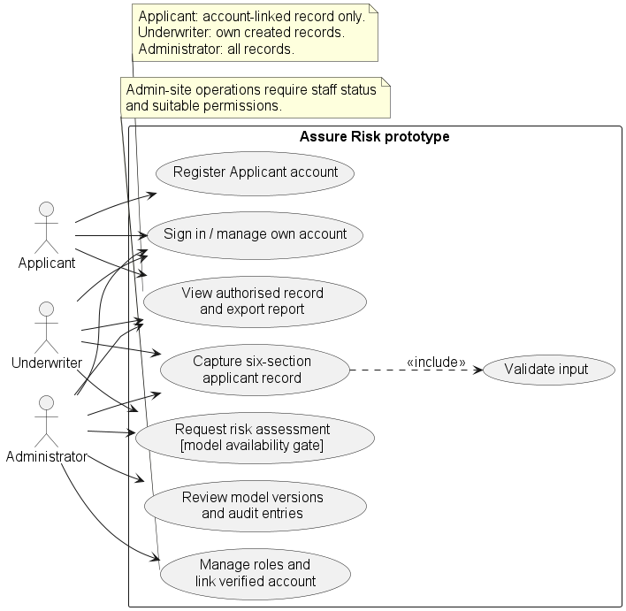
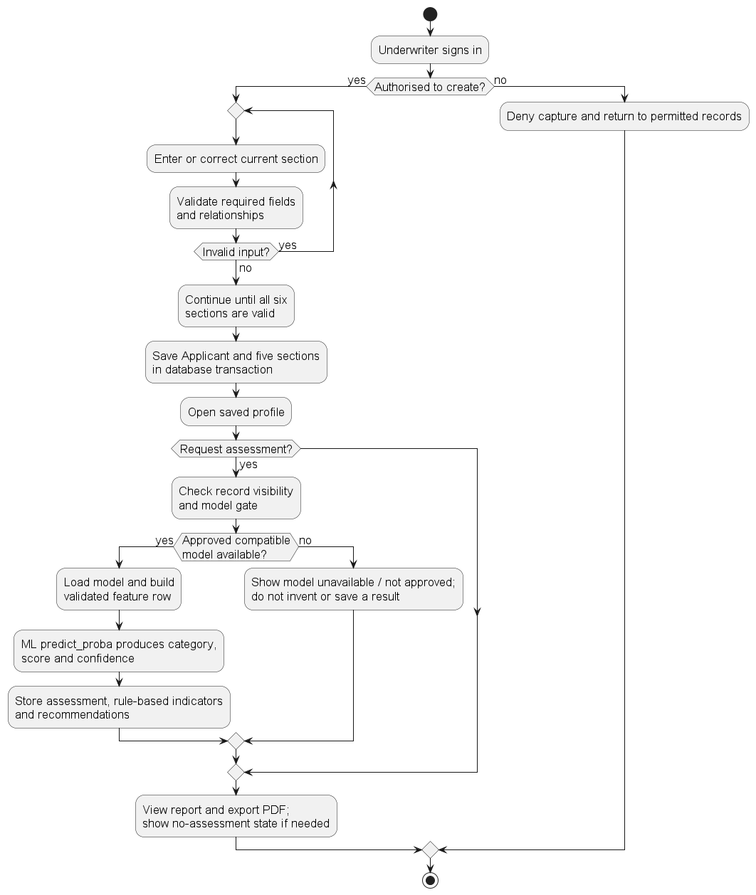
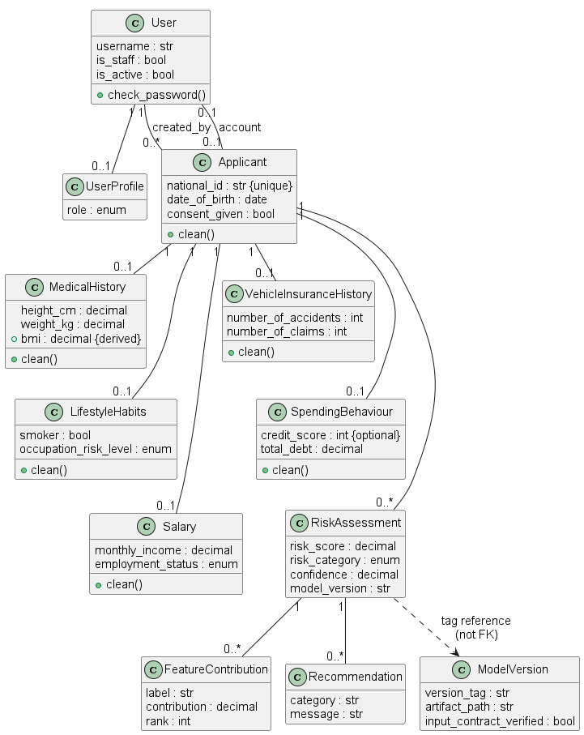
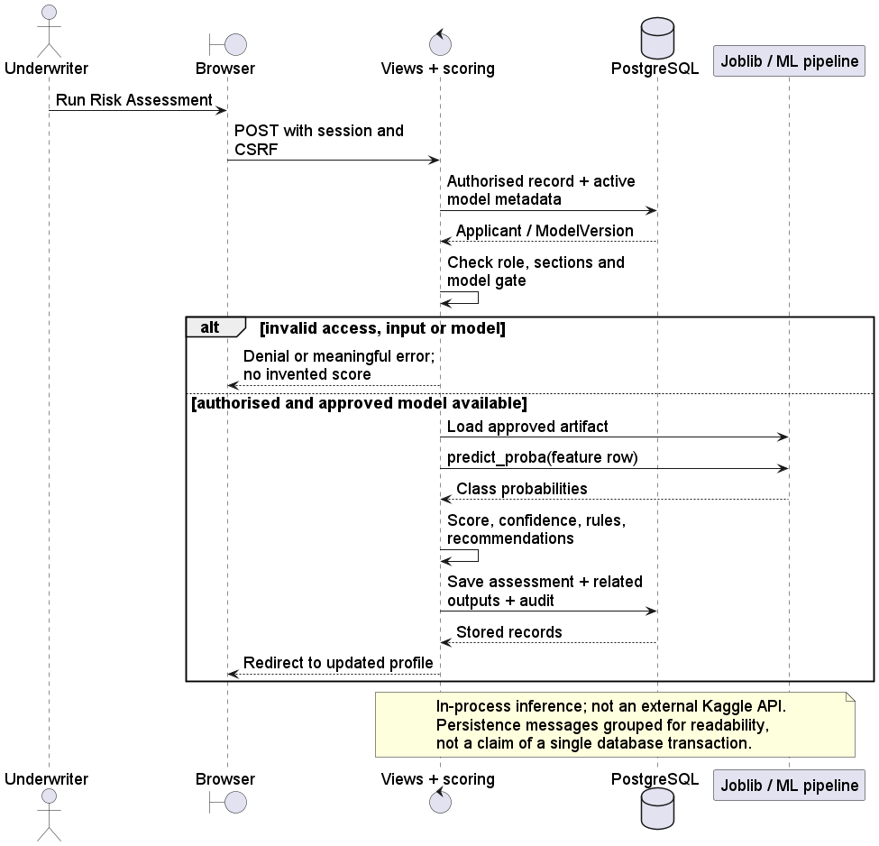
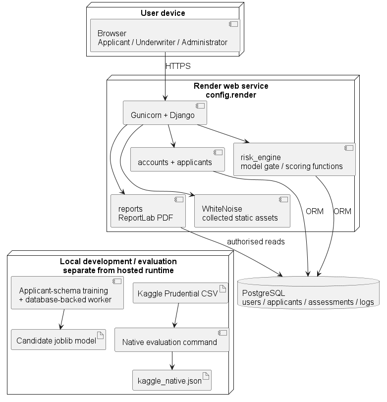

# ISJ107V Assignment 4 - Preparation Draft

Student: Mc Makwela (confirm)
Student number: TO BE PROVIDED

## 1. Prototype scope and requirements

### 1.1 Title, problem, users and emerging technology

Project: Integrated Life Insurance Risk Assessment System using Artificial Intelligence and Machine Learning (Assure Risk). The problem is fragmented collection and review of personal, medical, lifestyle and financial applicant information. The prototype centralises capture, validation, assessment records and report export. It supports review; it does not issue policies or automate an insurer's final decision.

The three roles are Applicant, Underwriter and Administrator. Applicants view an explicitly linked record. Underwriters capture and review records they created. Administrators manage access and oversee all records. Machine learning is the selected emerging technology in the prior project documentation; lecturer approval is to be confirmed by the student. [R2-R4]

### 1.2 Demonstrated scope versus implementation status

| ID / requirement | Status | Implementation and evidence to show |
| --- | --- | --- |
| FR-01 Registration and login | Implemented | Public registration creates Applicant accounts; privileged roles are administrator-assigned. E01 / TC01. |
| FR-02 Role-based visibility | Implemented | Account-linked Applicant records; creator-owned Underwriter records; Administrator oversight. E02 / TC02. |
| FR-03 Guided capture | Implemented | Six sections, consent and server-side validation; final transaction saves related records. E03 / TC03-04. |
| FR-04 Search and record review | Implemented | Search by name, ID or email within the authorised queryset. E04 / TC05. |
| FR-05 Report export | Implemented | Authorised HTML/PDF report with available assessment history. E05 / TC06. |
| ETR-01 ML risk assessment | Partial | In-process scoring code exists; no approved model provisioned for the supplied Render configuration. E06 / TC07-08. |
| FR-06 Model training and review | Partial | Local worker and CSV validation exist; Render uploads and activation disabled. |
| FR-07 Live Kaggle API / policy decisions | Deferred / out of scope | Offline Kaggle evaluation only; no online synchronization, policy issuance or approval workflow. |
Implemented describes source-code functionality, not a claim that each feature has passed a current hosted demonstration. The evidence IDs are capture targets, not screenshots already supplied. [R3-R6]

## 2. Setup, access and security

### 1.3 Setup and access instructions

Hosted address: https://assure-risk.onrender.com Repository: https://github.com/rk11machaba/Integrated-Life-Insurance-Risk-Assessment-System Working directory: C:\Double One Digital\Projects\Integrated Life Insurance Risk Assessment System

Hosted access needs a current browser and internet connection. A laptop with a keyboard and projector/display is recommended for presentation; no special sensor or GPU is required. For local preparation, use Python 3.14, the project dependencies, PostgreSQL (or the configured MySQL backend), and sufficient memory for the selected model. A 4 GB RAM laptop is a planning baseline, not a measured minimum.

Local preparation: install requirements.txt in a virtual environment; configure SECRET_KEY, DB_ENGINE, DB_NAME, DB_USER, DB_PASSWORD, DB_HOST, DB_PORT, ALLOWED_HOSTS and local DEBUG settings in a private environment file. Apply migrations and create the initial administrator using the normal management commands. Start manage.py runserver and browse the printed local address. Exact environment-specific instructions are in DEPLOYMENT.md. No setup commands were executed for this assignment pack.

Render uses config.render, bash deploy/render-build.sh and bash deploy/render-start.sh. The start script runs migrations and bootstrap_render_admin before Gunicorn. Administrator creation requires all three BOOTSTRAP_ADMIN_* values for a new username; the command never resets an existing password or promotes an existing non-superuser. Remove bootstrap values after successful creation. [R5]

### Demonstration access

Prepare three private demonstration accounts: Applicant, Underwriter and Administrator. Assign roles and verify logins before the session. Keep passwords out of this report and Git; provide any required assessment credentials privately to the lecturer. The recent live admin-login problem remains unresolved in the available conversation, so no usable hosted admin credential is claimed here.

### 2.4 Security and reliability controls

Django password hashing, authenticated views, explicit ownership filters, CSRF protection for session writes, and staff/permission checks protect core actions. Record access and exports generate audit entries. Render settings enforce HTTPS and secure cookies; environment values are not committed. Applicant email matching does not establish ownership. Never grant staff status to ordinary Underwriters: this implementation treats staff as administrator-level visibility. [R3, R5-R6]

Capture uses a database transaction for the Applicant and five supporting records. Invalid forms return field errors. Expected model-availability errors produce user feedback without fabricated results. This is not a claim of complete resilience: assessment, indicator and recommendation writes are not wrapped in one explicit transaction, so failure recovery and atomic scoring persistence remain corrective work. [R4, R6]

## 3. End-to-end workflow and persistent data

### 2.1 Demonstration workflow

1. Register an Applicant account and sign in. An Administrator verifies and assigns a separate Underwriter account; ordinary registration cannot select privileged roles. 2. As Underwriter, select New Applicant. Enter Personal, Medical, Lifestyle, Salary, Vehicle Insurance and Spending sections. 3. Show one invalid value, explain the error, correct it and continue. Required consent, age, identity format, medical limits and financial relationships are checked. 4. Save Applicant on the final step. Reopen the record from Applicants to show persistence. 5. As Administrator, verify ownership and set the record's Account field to the Applicant account. 6. As Applicant, view the linked record and demonstrate the absence of assessment/capture privileges. 7. Review/export a PDF. When an approved model exists, request an assessment and show its stored output; otherwise explicitly demonstrate the blocked branch. [R3-R6]

The earlier wizard sections live in the session until final save. Starting New Applicant again resets that capture session. This is not a permanent draft feature. Applicants currently view records; they do not self-submit the six-section application.

### 2.3 Data and state

The hosted configuration uses PostgreSQL. User/UserProfile hold authentication and roles. Applicant records identity, consent, creator and optional verified account link. Five one-to-one supporting models hold the domain data. RiskAssessment, FeatureContribution and Recommendation store output and history. ModelVersion stores artifact metadata and approval information. AuditLog stores selected user actions.

The Account link is one-to-one: an Applicant account can be linked to at most one applicant record, with many assessments for that record. Underwriters see records they created. Refreshing/reopening a saved record should retain it because it is stored in the database, not the browser session. This behaviour is a demonstration checkpoint, not a newly observed result.

### Meaningful outputs and boundaries

Outputs include a saved profile, authorised record list, validation messages, report PDF, and (when available) score, category, confidence and recommendations. No-assessment reports must not be presented as completed AI assessments. The regular report highlights the latest result; the assessment-specific API report selects its requested assessment.

Use the explicitly fictional manual data in the presentation notes, not real applicants or production credentials. Existing screenshot artifacts from earlier browser checks contain test fixtures and are not fresh evidence of the current hosted release.

## 4. Emerging technology, measures and risks

### 2.2 Machine-learning integration

The application scoring path constructs an applicant feature row, checks required sections and loads an approved joblib artifact. The schema-3 training pipeline imputes numeric missing values, scales numerics, one-hot encodes categories and fits GradientBoostingClassifier. Inference uses predict_proba; the maximum-probability class becomes the category. The score is a weighted combination of class probabilities (LOW 15, MEDIUM 50, HIGH 85), not a calibrated claim probability. [R6]

Confidence below the configured threshold flags manual review. Stored rule-based indicators are separate from model attribution; they must not be described as SHAP or feature-level explanations of the model. Production requires a verified input contract and passing accuracy/macro-F1 thresholds.

### 4.2 Quantitative measures from existing evidence

| Measure | Recorded result | Interpretation |
| --- | --- | --- |
| Native Kaggle internal-test accuracy | 75.06% | Below the 85% project target. |
| Native Kaggle internal-test macro F1 | 0.6718 | Below the 0.80 project target. |
| HIGH-class recall | 56.06% | 737 of 2,551 HIGH examples were predicted LOW. |
These are recorded offline results, not new tests or hosted scoring measurements. The native benchmark retained 59,351 of 59,381 records after removing duplicate predictors, with train/validation/test sizes 35,610 / 11,870 / 11,871. It selected a balanced histogram-gradient-boosting model by validation macro F1. This is distinct from the applicant-form pipeline. [R7-R8]

### 4.3 Important limitations and corrective actions

<b>Risk 1: incompatible training inputs.</b> The anonymised Kaggle predictors cannot be reconstructed from the live form. Obtain authorised, labelled applicant-schema data, review provenance and validate on independent data before production approval. Do not activate the native benchmark or invent conversions.

<b>Risk 2: incomplete hosted AI workflow.</b> Render disables uploads and activation and has no bundled approved artifact. Prepare and rehearse a separately labelled local demonstration of valid-input inference, or provision a validated compatible model with durable storage. An offline metric table or blocked scoring request alone does not satisfy a successful end-to-end emerging-technology demonstration.

Also resolve live admin access before presentation and make assessment persistence atomic. The old 93.5% accuracy claim in historical Assignment 3 text is superseded and must not be reused. [R7-R8]

## 5. Updated use-case diagram

### 3.1 Actors and prototype functions

All actors use the same application but have different record scopes. Applicant registration creates only an Applicant account. Administrator-only account linking is independent of capture. Capture includes validation; assessment is a separate command because a record can exist without a score. Model availability is a precondition, not proof of an operational hosted AI feature.

Source alignment: applicants/permissions.py, accounts/forms.py, applicants/views.py and risk_engine/views.py. Staff status and admin-site permissions remain additional access conditions. [R3-R6]

## 6. Workflow activity diagram

### 3.2 Decisions, alternative paths and emerging technology

The successful inference branch is implemented but conditional on a usable model. The current supplied hosted configuration takes the unavailable/approval-error branch. Administrator account linking is a separate workflow, not an automatic side effect of capture. [R4-R6]

## 7. Updated class diagram

### 3.3 Classes, operations and multiplicities

The five supporting records are optional at database level (0..1), but completed capture requires all five. Account ownership differs from record creation. An applicant can have many assessments. ModelVersion is referenced by a string, not a foreign key. clean() validates models; scoring is a module function. TrainingDataset and AuditLog are omitted from this core-domain view. [R3, R4, R6]

## 8. Assessment sequence diagram

### 3.4 UI, application logic, data and machine learning

The browser sends a CSRF-protected request. The view enforces visibility and role permissions before scoring. Model metadata is read from the database; joblib loads the artifact; scikit-learn produces probabilities. Saved outputs are then used by the profile and reports. This is not a network call to Kaggle or an external AI endpoint. Errors return meaningful feedback rather than an invented result. [R6]

## 9. Deployment and implementation differences

### 3.5 Prototype modules and execution environment

This is the supplied configuration, not a remotely inspected inventory. Render has no training worker, approved model artifact or Kaggle synchronization. The local worker polls database jobs; the Celery configuration is not the active queue. Native evaluation is separate from live scoring. Docker Compose is an alternative full-stack deployment, not this topology. Durable storage, model approval and operational verification remain necessary. [R5-R8]

## 10. Verification and evidence register

### 4.1 Representative cases: expected versus actual

No application tests were executed for this assignment preparation, following the student's instruction. The table is a current verification register, not a fabricated pass report. Existing test code specifies expected behaviour but is not fresh execution evidence. Complete the Actual/status column after authorised testing or observed rehearsal.

| Case | Action and expected result | Actual / status now |
| --- | --- | --- |
| TC01 / FR-01 | Register Applicant; valid data creates an account. Privileged role submission is rejected. | Not rerun; current hosted result pending. |
| TC02 / FR-02 | Applicant opens another record; access denied. Verified account link permits only its own record. | Not rerun; access checks inspected in source. |
| TC03 / FR-03 | Complete six sections and final save; record and five related sections persist. | Not rerun; record evidence required. |
| TC04 / FR-03 | Submit missing consent / invalid age / excessive claims; errors shown and no completed record saved. | Not rerun; field validators inspected. |
| TC05 / FR-04 | Reopen a saved record and search; database data retained within permitted scope. | Not rerun; persistence evidence required. |
| TC06 / FR-05 | Export authorised report; PDF has correct applicant/result. Unauthorised access denied. | Not rerun; actual PDF screenshot required. |
| TC07 / ETR-01 | In approved/local demo environment, valid feature row yields stored category, score and confidence. | Current successful demo not established. Must prepare before assessment. |
| TC08 / ETR-01 | Hosted missing/unverified model produces error, without fabricated assessment. | Configured to block; actual hosted feedback pending capture. |
Historical context: earlier development runs reported successful automated checks, but later UI changes invalidate an unchanged pass claim. In particular, accounts/test_demonstration.py still expects the removed academic banner. Update that obsolete assertion and obtain permission before rerunning. This is a source-inspection finding, not an executed failure.

Evidence to add: E01 login/registration; E02 account linking and access denial; E03 validation plus final save; E04 persisted profile/search; E05 exported PDF; E06 genuine inference input/output and stored result. Use fictional records, record the environment/date/commit, and redact all credentials.

## 11. Presentation and assessment readiness

### 5.1 / 5.3 Five-minute presentation

| Time | Slide / topic | Key message |
| --- | --- | --- |
| 0:00-0:40 | 1. Problem and purpose | One structured underwriting record instead of fragmented information. |
| 0:40-1:25 | 2. Users and workflow | Three roles, verified account linking, six-step capture and reports. |
| 1:25-2:10 | 3. Architecture | Django modules, PostgreSQL, Render and a separate local evaluation path. |
| 2:10-3:00 | 4. Emerging technology | Applicant pipeline versus native Kaggle benchmark; explain observable inference. |
| 3:00-3:45 | 5. Features and controls | Validation, authorised queries, secure credentials and report export. |
| 3:45-4:25 | 6. Results | 75.06% accuracy / 0.6718 macro F1; offline targets not met. |
| 4:25-5:00 | 7. Limits and next steps | Input compatibility, hosted model gap, admin access and fresh evidence. |
### 5.2 Ten-minute live demonstration

0-1 min: identify environment and prepared accounts. 1-4 min: capture six sections, show one validation error, then save. 4-5 min: reopen the persistent record. 5-6 min: administrator links the verified Applicant account. 6-7 min: Applicant views its own record and cannot assess. 7-9 min: demonstrate genuine input-to-model-to-stored-output integration in the prepared compatible environment. 9-10 min: export the PDF and explain the key limitation.

Fallback: keep the local environment available, plus pre-recorded demonstration and dated screenshots if permitted by the lecturer. Neither a recording nor the blocked scoring branch should be misrepresented as a successful live AI demonstration. Do not change production validation rules to make the presentation appear complete.

### 5.4 Individual understanding and readiness

Be ready to explain ownership filtering, transactional capture, model preprocessing, the label definition, leakage prevention, offline evaluation, PDF selection and deployment limits. Speaker notes include answers tied to the current implementation.

<b>Submission gate:</b> confirm student number and approved technology; resolve admin access; prepare the valid-input AI demonstration; record at least five actual case outcomes; attach dated screenshots; review and sign declarations. This report is a preparation draft until those items are completed.

## References

[R1] ISJ107V Assignment 4 S2 2026: Functional Prototype and Presentation. Supplied six-page assessment brief.
[R2] Assignment3_Consolidated_Final_Answers.md. Prior project title and technology baseline; superseded numeric claims are not reused.
[R3] accounts/forms.py; accounts/models.py; applicants/permissions.py; accounts/admin.py. Registration, roles and access rules.
[R4] applicants/views.py; applicants/forms.py; applicants/models.py. Capture, validation and relationships.
[R5] config/render.py; config/production.py; render.yaml; deploy/render-start.sh; RENDER_DEPLOYMENT.md; compose.yaml. Deployment and bootstrap.
[R6] risk_engine/pipeline.py; scoring.py; model_versions.py; api.py; models.py; reports/views.py. Inference, records and PDFs.
[R7] evaluation/kaggle_native.json; evaluation/RESULTS.md. Existing native-feature evaluation recorded 17 October 2026.
[R8] evaluation/MAPPING_AUDIT.md; evaluation/APPLICANT_DATA_CONTRACT.md. Input mapping limitations and labelled-data contract.
[R9] accounts/test_demonstration.py; applicants/tests.py; risk_engine/test_security_training.py; reports/tests.py. Test specifications, not fresh run evidence.
[R10] PlantUML. Download and Smetana layout documentation. https://plantuml.com/download and https://plantuml.com/smetana02 (accessed 30 October 2026). Diagrams rendered locally using the existing VS Code PlantUML installation.
[R11] Kaggle, Prudential Life Insurance Assessment data dictionary. https://www.kaggle.com/c/prudential-life-insurance-assessment/data/ (cited by the project mapping audit; not newly retrieved for this report).